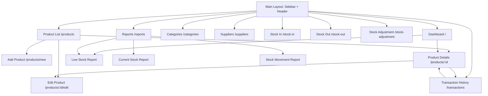

# Screen Navigation Flow

## Diagram (Mermaid)
Paste this into https://mermaid.live to view it and export a PNG for the submission.



## Text version
```
Main Layout (Sidebar + Header)
  Dashboard ............ product details, Low Stock report
  Products ............. Add Product, Product Details, Edit Product
        Product Details ... Edit Product, Transaction History (filtered by product)
  Categories ........... Add/Edit dialog
  Suppliers ............ Add/Edit dialog
  Stock In
  Stock Out
  Stock Adjustment
  Transactions ......... product details (click a product code)
  Reports .............. Current Stock | Stock Movement | Low Stock (tabs)
Unknown address ........ Page Not Found (back to Dashboard)
Unknown product id ..... Product Not Found (back to Products)
```